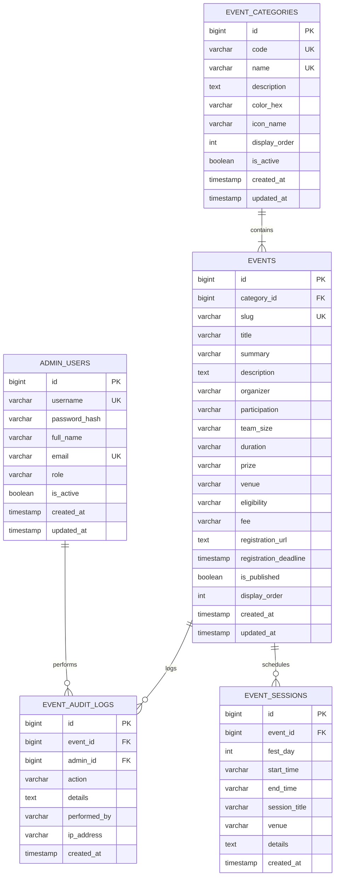

# ATRANG 2026–27 Full-Stack DBMS Mini-Project Report

**Institution:** Indian Institute of Information Technology Tiruchirappalli (IIIT Tiruchirappalli)  
**Course:** 24CS305 / CS3106 Database Management Systems Laboratory  
**Project Title:** Atrang 2026–27 Technical Fest Management & Event Administration System  
**Contributors:**
- **Yogesh** (`commit/yogesh`) — Database Architect & Migration Engineer
- **Shreyash** (`commit/shreyash`) — Backend Lead & API Security Engineer
- **Madhav** (`commit/madhav`) — Frontend Architect & Admin UX Engineer

---

## 1. Executive Summary & Problem Statement

Annual technical and cultural festivals in universities handle hundreds of events, multifaceted schedules, concurrent venue bookings, and changing coordination details. Without a centralized, normalized Relational Database Management System (RDBMS), institutions face data anomalies:
- Inconsistent schedule updates leading to double-booked venues.
- Unstructured category groupings causing multi-valued attributes and update anomalies.
- Security vulnerabilities from unverified client-side administrative access.

The **Atrang 2026–27 Management System** extends the Minecraft-themed festival platform into a full-stack, enterprise-grade architecture. It features a normalized PostgreSQL database, Flyway version-controlled migrations, automated audit triggers, complex analytical views, Spring Boot REST services, and an administrative interface.

---

## 2. Entity-Relationship (ER) Diagram

### Cardinalities & Relationships
1. **`EVENT_CATEGORIES` (1) to `EVENTS` (M):** One category hosts zero, one, or many events. Each event strictly belongs to exactly one category (`ON DELETE RESTRICT` maintains category integrity).
2. **`EVENTS` (1) to `EVENT_SESSIONS` (M):** One event can have multiple scheduled slots or rounds across festival days (`ON DELETE CASCADE` ensures clean lifecycle removal).
3. **`ADMIN_USERS` (1) to `EVENT_AUDIT_LOGS` (M):** Administrative actions are audited with optional foreign keys to admin users (`ON DELETE SET NULL` preserves historical audit trails).
4. **`EVENTS` (1) to `EVENT_AUDIT_LOGS` (M):** Event mutations trigger audit entries (`ON DELETE SET NULL` preserves audit logs even if an event is archived).

---

## 3. Relational Schema & Constraints

### 3.1 Relational Notation
- $\text{admin\_users}(\underline{\text{id}}, \text{username}, \text{password\_hash}, \text{full\_name}, \text{email}, \text{role}, \text{is\_active}, \text{created\_at}, \text{updated\_at})$
- $\text{event\_categories}(\underline{\text{id}}, \text{code}, \text{name}, \text{description}, \text{color\_hex}, \text{icon\_name}, \text{display\_order}, \text{is\_active}, \text{created\_at}, \text{updated\_at})$
- $\text{events}(\underline{\text{id}}, \text{category\_id}^*, \text{slug}, \text{title}, \text{summary}, \text{description}, \text{organizer}, \text{participation}, \text{team\_size}, \text{duration}, \text{prize}, \text{venue}, \text{eligibility}, \text{fee}, \text{registration\_url}, \text{registration\_deadline}, \text{is\_published}, \text{display\_order}, \text{created\_at}, \text{updated\_at})$
- $\text{event\_sessions}(\underline{\text{id}}, \text{event\_id}^*, \text{fest\_day}, \text{start\_time}, \text{end\_time}, \text{session\_title}, \text{venue}, \text{details}, \text{created\_at})$
- $\text{event\_audit\_logs}(\underline{\text{id}}, \text{event\_id}^*, \text{admin\_id}^*, \text{action}, \text{details}, \text{performed\_by}, \text{ip\_address}, \text{created\_at})$

### 3.2 Constraint Matrix
| Table | Primary Key | Foreign Key | UNIQUE Constraints | CHECK Constraints | DEFAULT Values |
|---|---|---|---|---|---|
| `admin_users` | `id` | None | `username`, `email` | `char_length(username) >= 3`, `email LIKE '%@%._%'`, `role IN (...)` | `role='ROLE_ADMIN'`, `is_active=TRUE`, `created_at=NOW()` |
| `event_categories` | `id` | None | `code`, `name` | `color_hex ~* '^#[0-9A-Fa-f]{6}$'`, `char_length(code) >= 2` | `color_hex='#a46bff'`, `display_order=0` |
| `events` | `id` | `category_id` $\rightarrow$ `event_categories.id` | `slug` | `participation IN ('Individual', 'Team', 'Individual or Team')`, `slug ~* '^[a-z0-9-]+$'` | `organizer='Atrang Committee'`, `is_published=FALSE` |
| `event_sessions` | `id` | `event_id` $\rightarrow$ `events.id` | None | `fest_day BETWEEN 1 AND 7` | `created_at=NOW()` |
| `event_audit_logs` | `id` | `event_id`, `admin_id` | None | `action IN ('CREATE', 'UPDATE', 'DELETE', 'PUBLISH', 'UNPUBLISH', 'LOGIN', 'LOGOUT')` | `performed_by='SYSTEM'`, `created_at=NOW()` |

---

## 4. Normalization Analysis (3NF Proof)

A relational database schema is normalized through Third Normal Form (3NF) to eliminate insertion, deletion, and modification anomalies.

### First Normal Form (1NF)
**Condition:** Each column must contain atomic (indivisible) values, and each record must be unique.
- **Verification:**
  - In legacy designs, schedule slots (e.g. "Day 1 10AM, Day 2 2PM") or coordinator contacts were stored as comma-separated text inside `events`.
  - In our schema, schedule slots are decomposed into individual rows in the `event_sessions` table.
  - Every attribute holds a single atomic value ($D_{ij}$ contains only atomic elements).
  - All tables possess a designated primary key (`id`). Hence, the schema satisfies **1NF**.

### Second Normal Form (2NF)
**Condition:** The relation is in 1NF and no non-prime attribute is partially dependent on any candidate key (full functional dependency).
- **Verification:**
  - In each table, the primary key is a single surrogate key (`id BIGSERIAL`).
  - Because no candidate key is composite, a partial key dependency cannot exist mathematically ($X \rightarrow Y$ where $X \subset CK$).
  - Every non-prime attribute depends on the entire candidate key. Hence, the schema satisfies **2NF**.

### Third Normal Form (3NF)
**Condition:** The relation is in 2NF and no non-prime attribute is transitively dependent on the primary key ($X \rightarrow Y$ and $Y \rightarrow Z$ where $Z$ is non-prime is disallowed).
- **Verification:**
  - In an unnormalized design, `events` might contain `category_name`, `category_color`, and `category_icon`. This creates a transitive dependency:
    $$\text{events.id} \rightarrow \text{events.category\_code} \rightarrow \{\text{category\_name}, \text{category\_color}\}$$
    If all events in a category are deleted, the category metadata would be lost (deletion anomaly).
  - In our schema, category attributes are extracted into `event_categories`. `events` retains only the foreign key `category_id`.
  - In `event_sessions`, session venue and timing depend on `session_id`, not on `event_id` alone.
  - In `event_audit_logs`, administrator details are stored in `admin_users` and referenced by `admin_id`.
  - For every functional dependency $X \rightarrow A$, either $X$ is a superkey or $A$ is a prime attribute.
  - Hence, the schema is strictly in **Third Normal Form (3NF)**.

---

## 5. Advanced Database Objects

### 5.1 Relational Views
1. **`v_event_details`**: Consolidates `events`, `event_categories`, and an aggregated count of sub-sessions via `LEFT JOIN` and `GROUP BY`. Provides clean, unified reads for public and admin catalog listings.
2. **`v_category_metrics`**: Analytical aggregate view calculating total events, published events, draft counts, and total scheduled sessions per technical domain/biome.

### 5.2 Stored Procedures & Functions
1. **`fn_get_fest_stats()`**: A PL/pgSQL function returning system-wide scalar metrics in a single network round-trip.
2. **`sp_toggle_event_publication(p_event_id, OUT p_new_status)`**: An atomic procedure to safely toggle public visibility with validation.

### 5.3 Automated Database Triggers
1. **`trg_events_audit_log`**: Executes `fn_audit_event_mutation()` `AFTER INSERT OR UPDATE OR DELETE ON events`. Automatically captures changes, categorizes them as `CREATE`, `UPDATE`, `PUBLISH`, `UNPUBLISH`, or `DELETE`, and logs them in `event_audit_logs`.
2. **`trg_update_timestamp`**: Executes `fn_update_timestamp()` `BEFORE UPDATE` on mutable tables to maintain ISO timestamps.

---

## 6. Flyway Versioning Strategy

All database structures are version-controlled under `backend/src/main/resources/db/migration/`:
- `V1__create_admin_users.sql`
- `V2__create_event_categories.sql`
- `V3__create_events.sql`
- `V4__create_event_sessions.sql`
- `V5__create_event_audit_logs.sql`
- `V6__add_constraints_and_indexes.sql`
- `V7__create_reporting_views.sql`
- `V8__create_functions_and_triggers.sql`
- `V9__insert_sample_data.sql`

Flyway automatically validates migration checksums on application startup, preventing unauthorized drift between database environments.

---

## 7. Viva Voce Quick Preparation Guide

**Q1: Why did you separate event categories and event sessions into distinct tables?**  
*Answer:* To eliminate multi-valued attributes and achieve 3NF. Storing multiple sessions or category details in the `events` table creates transitive dependencies and update anomalies.

**Q2: What is the purpose of the Flyway schema history table?**  
*Answer:* Flyway tracks migration versions, execution timestamps, execution status, and SHA-256 checksums in `flyway_schema_history` to ensure reproducibility across development, testing, and production.

**Q3: How do you prevent SQL injection?**  
*Answer:* All database interactions in Spring Data JPA use parameterized queries (`PreparedStatement`), eliminating inline string concatenation.

**Q4: How does the audit trigger work?**  
*Answer:* The `trg_events_audit_log` fires `AFTER INSERT OR UPDATE OR DELETE`. Using the `TG_OP` variable and `NEW`/`OLD` pseudo-records, it automatically writes an immutable record to `event_audit_logs`.
